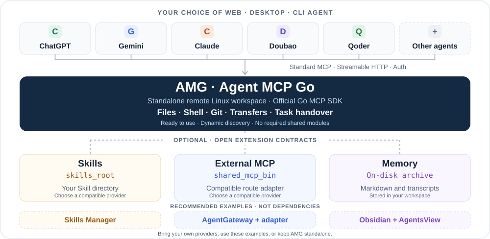

# AMG · Agent MCP Go

**English** | [简体中文](README.zh-CN.md)

**Give your AI agent a real Linux workspace.** One authenticated [MCP](https://modelcontextprotocol.io/) endpoint lets your preferred agent inspect files, edit projects, execute Shell commands, use Git, and transfer files remotely.

**Ready to use · Dynamic discovery · Freedom of choice**



### Start in three steps

1. [Install and start AMG on Linux](#quick-start). The standalone Go server needs no Skills manager, MCP gateway, or memory service to provide its core tools.
2. [Connect your preferred agent](#4-connect-a-client) using its native remote MCP connector, server URL and supported authentication.
3. Start working: ask “Inspect your environment and list the workspace.” Add optional integrations only if you need them.

[Quick start](#quick-start) · [Configuration](docs/configuration.md) · [Integrations](docs/integrations.md) · [Security](docs/security.md) · [Release notes](docs/releases/v1.2.1.md)

## Open, dynamic and ready to use

- **Use the agent you prefer.** Designed for compatible web, desktop and CLI MCP clients, including ChatGPT, Gemini, Claude, Doubao Work, Qoder/QoderWork, and other clients supporting Streamable HTTP and Bearer or OAuth authentication. No specific model vendor is required. Client approvals, attachments and long-running session behavior must be verified separately.
- **Discover capabilities as needed.** AMG provides agent instructions and a bounded Skills preview at initialization/discovery. It reads full Skills and current external tool schemas on demand. Changes to existing Skill contents or the live route catalog are available on the next relevant request without rebuilding AMG or restarting it. An already loaded client context is not automatically replaced.
- **Bring your own ecosystem.** AMG uses the official Go MCP SDK and runs independently. Use your own Skill directory, compatible MCP route adapter and on-disk memory archive, or none at all. No bundled shared stack, duplicate registry or background catalog refresher.

## Optional integrations and recommended ecosystem

| Capability | Open integration contract | Recommended example |
| --- | --- | --- |
| Skills | [`skills_root`](docs/integrations.md#local-skills): existing Skill directory | Skills Manager |
| External MCP tools | [`shared_mcp_bin`](docs/integrations.md#shared-mcp-cli-contract): compatible stdio route adapter | [AgentGateway](https://github.com/agentgateway/agentgateway) with a compatible adapter |
| Persistent memory | [On-disk archive](docs/integrations.md#task-continuity-and-memory): durable Markdown/transcript archive in the workspace | [Obsidian](https://obsidian.md/) + [AgentsView](https://github.com/kenn-io/agentsview) |

These are recommendations, not dependencies. Any alternatives meeting the documented contracts can be used. The route adapter is an executable, not a gateway URL; direct tool calls require a reachable Streamable HTTP route and do not inject custom upstream authorization headers. See the [integration contract](docs/integrations.md#shared-mcp-cli-contract). AMG does not install or manage these providers.

## What it provides

- Workspace browsing, search, text reads and writes, structured patches, and image inspection.
- Shell execution with bounded output, resumable process sessions, stdin, and cancellation; Git operations and project instructions.
- Streaming file transfer, chunked uploads, and MCP resource export.
- Change review, task plans, notes, and scoped handover across connections.
- Concurrent multi-agent operation: the notes and plans of one scope are serialized under a per-scope lock, so independent scopes run in parallel and one scope is never written twice at once. Review baselines serialize per repository and keep per-scope Git refs.
- Fresh agent instructions at initialization/discovery include the live Skill catalogue and project rules under the configurable text budget, without fixed entry or description counts. Full Skill bodies are read on demand.
- `settings_get` shows all 14 live settings. `settings_update` can change any subset of the 10 resource caps, optional `bootstrap_files`, `annotations_mode`, and Shell yield bounds (`default_yield_ms` and `max_yield_ms`) without a restart.
- Optional live discovery and calls to an existing shared MCP installation, without a bundled shared stack.
- Optional OAuth 2.1 authorization server for hosted MCP clients (Google Gemini Web, Claude Web, ChatGPT): PKCE, dynamic client registration, an owner-consent page, and non-rotating refresh tokens.

**Validated platform:** Linux amd64. Building requires **Go 1.25+**. Shell tools require a POSIX shell; Git operations require Git on the server. Interactive TTY programs are unsupported.

**Trust model:** a Bearer token grants code execution as the server's OS user. Run AMG under a dedicated account and read the [security model](docs/security.md) before exposing it remotely. The owner Bearer token always keeps full access; the optional OAuth server issues revocable client tokens on top of it.

## Quick start

The commands below require Linux amd64, `curl`, GNU `sha256sum`, `tar`, and Python 3. Use a new installation directory.

### 1. Download and verify

```sh
mkdir amg-v1.2.1
cd amg-v1.2.1
release=https://github.com/bsbofmusic/agent-mcp-go/releases/download/v1.2.1
curl -fLO "$release/agent-mcp-go-v1.2.1-linux-amd64.tar.gz"
curl -fLO "$release/checksums.txt"
sha256sum --ignore-missing -c checksums.txt
tar -xzf agent-mcp-go-v1.2.1-linux-amd64.tar.gz
install -Dm755 agent-mcp-go "$HOME/.local/bin/agent-mcp-go"
```

Continue only when the archive checksum reports `OK`. Checksums detect changed bytes; obtain both files from the intended release.

### 2. Create a personal configuration

The packaged [example configuration](config.example.json) uses placeholder paths under `/home/amg`. This script replaces them with absolute paths for your actual home, creates the workspace/state/Skills directories, and creates an owner-only random token. It refuses to overwrite an existing configuration or token.

```sh
python3 - <<'PY'
import json, os, secrets
from pathlib import Path

os.umask(0o077)
home = Path.home().resolve()
config_dir = home / ".config/agent-mcp-go"
config_dir.mkdir(parents=True, exist_ok=True, mode=0o700)
config_path = config_dir / "config.json"
token_path = config_dir / "mcp-token"
if config_path.exists() or token_path.exists():
    raise SystemExit("Existing config/token found; review them instead of overwriting.")
config = json.loads(Path("config.example.json").read_text())
config.update({
    "listen": "127.0.0.1:3100",
    "work_root": str(home / "workspace"),
    "default_workdir": str(home / "workspace"),
    "state_dir": str(home / ".local/state/agent-mcp-go"),
    "skills_root": str(home / ".config/agent-mcp-go/skills"),
    "token_file": str(token_path),
    "public_url": "http://127.0.0.1:3100",
    "allowed_origins": [],
    "shared_mcp_bin": "",
    "executable_dirs": [],
})
for key in ("work_root", "state_dir", "skills_root"):
    Path(config[key]).mkdir(parents=True, exist_ok=True, mode=0o700)
with token_path.open("x") as f:
    f.write(secrets.token_hex(32) + "\n")
token_path.chmod(0o600)
with config_path.open("x") as f:
    json.dump(config, f, indent=2)
    f.write("\n")
config_path.chmod(0o600)
print("Configuration:", config_path)
PY
```

The server does not expand `~` or `$HOME` inside JSON path strings. Shell expansion in the following command happens before AMG receives the path.

### 3. Start in the foreground

```sh
"$HOME/.local/bin/agent-mcp-go" --config "$HOME/.config/agent-mcp-go/config.json"
```

In another terminal:

```sh
curl -fsS http://127.0.0.1:3100/healthz
```

The response body is `ok` followed by a newline. Health is unauthenticated and does not establish MCP authentication or client compatibility.

### 4. Connect a client

Configure a client that supports Streamable HTTP and a static Authorization header:

| Setting | Value |
| --- | --- |
| URL | `http://127.0.0.1:3100/mcp` for a client on the same machine |
| Header name | `Authorization` |
| Header value | `Bearer <contents of your mcp-token file>` |

Use `/mcp/stateless` for clients that do not preserve `Mcp-Session-Id`. Both endpoints accept the owner Bearer token, and — when OAuth is enabled — access tokens issued by the built-in authorization server.

Hosted clients that require a browser sign-in flow (Google Gemini Web Connected Apps, Claude Web, ChatGPT) can use that OAuth 2.1 server instead of a static header. Set `public_url` to the public HTTPS origin and add an `oauth` block to the configuration; see [Gemini Web and OAuth clients](docs/integrations.md#gemini-web-and-oauth-clients).

For repeated Gemini tool confirmations, see [host-owned tool approvals](docs/integrations.md#gemini-repeated-tool-confirmations). OAuth connection consent does not guarantee unattended tool execution.

For remote clients, supply your own HTTPS reverse proxy or tunnel, set `public_url` to its external origin, and forward `/mcp`, `/mcp/stateless`, and `/transfer/` as needed. AMG listens only on loopback and does not install or manage ingress. Browser clients from another origin need an explicit `allowed_origins` entry. See [client and proxy integration](docs/integrations.md).

Ask the connected agent to inspect its environment and list the workspace. SDK/protocol compatibility does not guarantee a host's native cards, attachment import, or download UI; verify those in your chosen client.

## Run several agents against one server

Task state is scoped. The notes and plans of one scope are serialized against each other under a per-scope lock, while different scopes run fully in parallel; review baselines serialize per repository and use per-scope Git refs. Give every concurrent agent its own explicit `scope` value, and give every agent that edits the same repository its own `git worktree` checkout; pass that checkout path as the `workdir` of `run_command` or the `directory` of the Git tools. Keep shared services and configuration switches single-writer.

Anonymous MCP sessions keep task state for 30 days and are then cleaned up automatically. Use an explicit scope for work that must survive longer than that.

## Build and verify

From the source tree with Go 1.25+:

```sh
CGO_ENABLED=0 go test -count=1 ./...
CGO_ENABLED=0 go vet ./...
CGO_ENABLED=0 go build -buildvcs=false -trimpath -o agent-mcp-go .
```

Network tests are opt-in and require an explicit `AGENT_MCP_GO_CONFIG` path. They may execute commands or create temporary files on the configured server; use a disposable workspace. See [release verification](docs/releases/v1.2.1.md#installation-and-verification).

## Documentation

- [Configuration](docs/configuration.md): required fields, OAuth settings, limits, paths, and service setup.
- [Integrations](docs/integrations.md): HTTP clients, optional Skills/shared MCP, and scope continuity.
- [Security](docs/security.md): OS permissions, token handling, transfer URLs, and concurrency limits.
- [Changelog](CHANGELOG.md) and [v1.2.1 release notes](docs/releases/v1.2.1.md).

## Acknowledgments and license

AMG is released under the [MIT License](LICENSE). [Codex Free](https://github.com/hypnguyen1209/codex-free) informed parts of the workspace tool behavior and documentation organization. The bundled review UI is adapted from Codex Free v1.9.1, copyright © 2026 hypnguyen1209, under MIT; it includes [Prism](https://prismjs.com/), copyright © 2012 Lea Verou, also under MIT. Their notices are retained in [the asset license](assets/CODEXFREE-REVIEW-LICENSE.txt).
