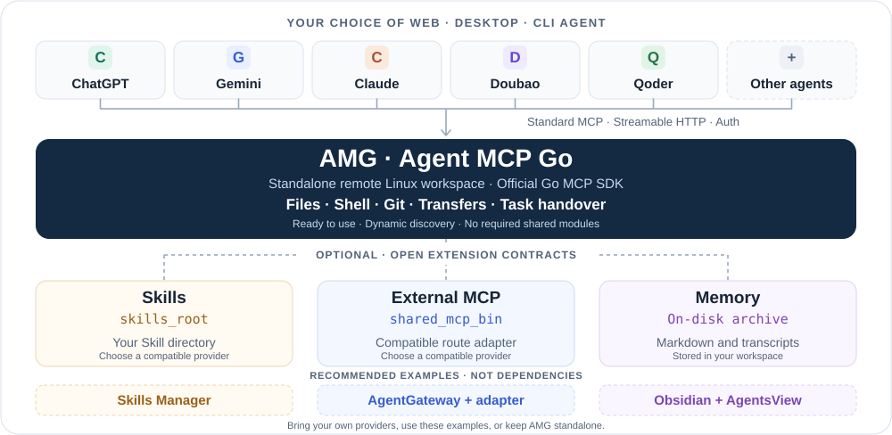

# AMG · Agent MCP Go

[English](README.md) | **简体中文**

**让你的 AI Agent 拥有真正可操作的远程 Linux 工作空间。** 只需一个经过认证的 [MCP](https://modelcontextprotocol.io/) 入口，就能让你喜欢的 Agent 远程读写文件、修改项目、执行 Shell 命令、操作 Git 和传输文件。

**开箱即用 · 动态发现 · 自由接入**



### 三步开始使用

1. [在 Linux 或 VPS 上安装并启动 AMG](#快速开始)。独立 Go 服务无需 Skills 管理器、MCP 网关或记忆服务，即可提供原生执行能力。
2. [连接你喜欢的 Agent](#4-连接客户端)。在客户端原生远程 MCP 连接器中填写服务地址和支持的认证信息。
3. 开始工作：直接对 Agent 说“检查你的运行环境，列出工作空间文件。” 需要额外能力时，再选配共享模块。

[快速开始](#快速开始) · [配置](docs/configuration.md) · [接入指南](docs/integrations.md) · [安全说明](docs/security.md) · [发行说明](docs/releases/v1.1.7.md)

> 本页为英文 [README](README.md) 的简体中文版。详细配置与协议说明以对应的原始文档为准；修改英文 README 时，同步检查本页。

## 开箱即用、动态、自由

- **Agent 自由选择。** 面向 ChatGPT、Gemini、Claude、豆包工作（Doubao Work）、Qoder/QoderWork，以及其他支持 Streamable HTTP 和 Bearer 或 OAuth 认证的网页端、桌面端与 CLI Agent。无需绑定特定模型厂商；各客户端的操作审批、附件和长任务体验需分别验证。
- **能力动态发现。** 初始化和发现阶段提供 Agent 指令及有界 Skills 预览，需要时读取完整 Skill、发现外部工具及其当前 Schema。已有 Skill 内容或实时路由目录发生变化，下次相关请求即可读取新内容，无需重新编译或重启 AMG；已加载的客户端上下文不会自动替换。
- **生态自由搭配。** AMG 使用官方 Go MCP SDK，核心独立运行。用户可以接入自己的 Skill 目录、兼容的 MCP 路由适配器和记忆工具，也可以完全不用共享模块。不捆绑共享基础设施、不重复建立注册表、不启动后台目录刷新器。

## 可选扩展与推荐生态

| 能力 | 开放接入契约 | 推荐方案（仅作示例） |
| --- | --- | --- |
| Skills | [`skills_root`](docs/integrations.md#local-skills)：已有 Skill 目录 | Skills Manager |
| 外部 MCP 工具 | [`shared_mcp_bin`](docs/integrations.md#shared-mcp-cli-contract)：兼容的 stdio 路由适配器 | [AgentGateway](https://github.com/agentgateway/agentgateway) + 兼容适配器 |
| 长期记忆 | [外部 MCP 路由](docs/integrations.md#task-continuity-and-memory)：由自选服务提供记忆工具 | [MemOS](https://github.com/MemTensor/MemOS)，可搭配 [AgentsView](https://github.com/kenn-io/agentsview) 和 [Obsidian](https://obsidian.md/) 管理会话与持久笔记 |

以上是推荐组合，不是强制依赖。符合公开契约的替代方案均可接入。路由适配器是可执行程序，并非直接填写网关 URL；直接调用工具需要 AMG 能访问的 Streamable HTTP 路由，且不会自动添加上游自定义认证头。详见[接入契约](docs/integrations.md#shared-mcp-cli-contract)。AMG 不负责安装或管理这些外部服务。

## 主要能力

- 浏览工作空间、搜索、读写文本文件、应用结构化补丁及查看图片。
- Shell 命令执行（限制输出大小、支持续接进程会话、标准输入和取消执行），以及 Git 操作与项目指令读取。
- 流式文件传输、分块上传和 MCP 资源导出。
- 变更审查、任务计划、笔记，以及按任务范围跨连接交接。
- 多 Agent 并发：同一 `scope` 的笔记和计划由该 scope 的锁串行保护，不同 scope 可并行运行，避免同一 scope 被同时写入；审查基线按仓库串行处理，并保留各 scope 的 Git 引用。
- 在初始化和发现阶段提供最新的 Agent 指令，最大 32 KiB，其中 Skills 目录预览最大 13 KiB；完整 Skill 内容按需读取。
- 可选接入已有共享 MCP，实时发现和调用工具，不捆绑部署整套共享基础设施。
- 可选内置 OAuth 2.1 授权服务器，面向需要网页登录的 MCP 客户端（Google Gemini Web、Claude Web、ChatGPT），支持 PKCE、动态客户端注册、所有者授权页面，以及不轮换的刷新令牌。

**已验证平台：** Linux amd64。源码构建需要 **Go 1.25+**；Shell 工具需要 POSIX shell，Git 操作需要服务器安装 Git。不支持交互式 TTY 程序。

**安全信任模型：** Bearer 令牌允许以服务器上的运行账户身份执行代码。建议使用专用系统账户运行 AMG，对外开放前务必阅读[安全模型](docs/security.md)。所有者 Bearer 令牌始终拥有完整访问权限，可选 OAuth 服务则在此基础上签发可撤销的客户端令牌。

## 快速开始

以下命令需要 Linux amd64、`curl`、GNU `sha256sum`、`tar` 和 Python 3。请使用新的安装目录。

### 1. 下载并校验

```sh
mkdir amg-v1.1.7
cd amg-v1.1.7
release=https://github.com/bsbofmusic/agent-mcp-go/releases/download/v1.1.7
curl -fLO "$release/agent-mcp-go-v1.1.7-linux-amd64.tar.gz"
curl -fLO "$release/checksums.txt"
sha256sum --ignore-missing -c checksums.txt
tar -xzf agent-mcp-go-v1.1.7-linux-amd64.tar.gz
install -Dm755 agent-mcp-go "$HOME/.local/bin/agent-mcp-go"
```

仅当压缩包校验结果为 `OK` 时继续。校验和用于检测文件字节是否发生变化；请确保压缩包和校验文件都来自目标发行版本。

### 2. 创建个人配置

发行包中的[示例配置](config.example.json)使用 `/home/amg` 下的占位路径。以下脚本会将其替换为实际主目录下的绝对路径，创建工作空间、状态和 Skills 目录，并生成仅所有者可访问的随机令牌。若配置或令牌已存在，脚本会拒绝覆盖。

```sh
python3 - <<'PY'
import json, os, secrets
from pathlib import Path

os.umask(0o077)
home = Path.home().resolve()
config_dir = home / ".config/agent-mcp-go"
config_dir.mkdir(parents=True, exist_ok=True, mode=0o700)
config_path = config_dir / "config.json"
token_path = config_dir / "mcp-token"
if config_path.exists() or token_path.exists():
    raise SystemExit("Existing config/token found; review them instead of overwriting.")
config = json.loads(Path("config.example.json").read_text())
config.update({
    "listen": "127.0.0.1:3100",
    "work_root": str(home / "workspace"),
    "default_workdir": str(home / "workspace"),
    "state_dir": str(home / ".local/state/agent-mcp-go"),
    "skills_root": str(home / ".config/agent-mcp-go/skills"),
    "token_file": str(token_path),
    "public_url": "http://127.0.0.1:3100",
    "allowed_origins": [],
    "shared_mcp_bin": "",
    "executable_dirs": [],
})
for key in ("work_root", "state_dir", "skills_root"):
    Path(config[key]).mkdir(parents=True, exist_ok=True, mode=0o700)
with token_path.open("x") as f:
    f.write(secrets.token_hex(32) + "\n")
token_path.chmod(0o600)
with config_path.open("x") as f:
    json.dump(config, f, indent=2)
    f.write("\n")
config_path.chmod(0o600)
print("Configuration:", config_path)
PY
```

服务端不会展开 JSON 路径字符串中的 `~` 或 `$HOME`。以下命令中的变量由 Shell 在传入 AMG 之前展开。

### 3. 前台启动

```sh
"$HOME/.local/bin/agent-mcp-go" --config "$HOME/.config/agent-mcp-go/config.json"
```

在另一个终端执行：

```sh
curl -fsS http://127.0.0.1:3100/healthz
```

响应正文应为 `ok`，后跟换行符。健康检查无需认证，它并不能证明 MCP 认证或客户端兼容性已经通过。

### 4. 连接客户端

对于支持 Streamable HTTP 且可设置静态 Authorization 请求头的客户端，填写：

| 设置项 | 值 |
| --- | --- |
| URL | 同一机器上的客户端使用 `http://127.0.0.1:3100/mcp` |
| 请求头名称 | `Authorization` |
| 请求头值 | `Bearer <你的 mcp-token 文件内容>` |

对于不保留 `Mcp-Session-Id` 的客户端，请使用 `/mcp/stateless`。两个端点都接受所有者 Bearer 令牌；开启 OAuth 后，也接受内置授权服务器签发的访问令牌。

需要浏览器登录流程的托管客户端（Google Gemini Web Connected Apps、Claude Web、ChatGPT）可使用内置 OAuth 2.1 服务，而无需静态请求头。将 `public_url` 设置为公网 HTTPS 源站地址，在配置中加入 `oauth` 配置块，详见 [Gemini Web 与 OAuth 客户端](docs/integrations.md#gemini-web-and-oauth-clients)。

**Gemini 授权提醒：** OAuth 连接授权不代表所有工具都能免审批；每次操作是否需要确认由客户端决定。若选择“始终允许”后仍反复弹窗，请查看[重复工具确认排障说明](docs/integrations.md#gemini-repeated-tool-confirmations)，不要通过修改工具风险声明来绕过门禁。

对于远程客户端，请自行提供 HTTPS 反向代理或隧道，将 `public_url` 设置为外部访问源站地址，并按需转发 `/mcp`、`/mcp/stateless` 和 `/transfer/`。AMG 仅监听回环地址，不安装或管理公网入口。来自其他源站的浏览器客户端需要显式加入 `allowed_origins`。详见[客户端与代理接入指南](docs/integrations.md)。

连接后，可以请 Agent 检查运行环境并列出工作空间。SDK 和协议兼容并不保证宿主支持原生卡片、附件导入或下载界面，请在实际使用的客户端中验证这些能力。

## 多 Agent 共用同一服务器

任务状态按 `scope` 隔离。同一 scope 的笔记和计划由专属锁串行保护，不同 scope 可以并行运行；审查基线按仓库串行处理，并使用各 scope 的 Git 引用。为每个并发 Agent 指定独立的 `scope` 值；如果多个 Agent 同时编辑同一仓库，还应为每个 Agent 分配独立的 `git worktree` 工作树，并将工作树路径作为 `run_command` 的 `workdir`，或 Git 工具的 `directory`。共享服务和配置切换应由单一写入者负责。

匿名 MCP 会话的任务状态保留 30 天，之后自动清理。需要更长时间保留的任务请使用显式 scope。

## 源码构建与验证

在安装了 Go 1.25+ 的环境中，进入源码目录执行：

```sh
CGO_ENABLED=0 go test -count=1 ./...
CGO_ENABLED=0 go vet ./...
CGO_ENABLED=0 go build -buildvcs=false -trimpath -o agent-mcp-go .
```

网络测试默认不启用，需要显式指定 `AGENT_MCP_GO_CONFIG` 配置路径。测试可能在配置指定的服务器上执行命令或创建临时文件，请使用可丢弃的工作空间。详见[发行版本验证说明](docs/releases/v1.1.7.md#installation-and-verification)。

## 文档

- [配置说明](docs/configuration.md)：必填字段、OAuth 设置、限制、路径及服务部署。
- [接入指南](docs/integrations.md)：HTTP 客户端、可选 Skills / 共享 MCP 及 scope 连续性。
- [安全说明](docs/security.md)：系统账户权限、令牌处理、传输链接和并发限制。
- [变更日志](CHANGELOG.md)与 [v1.1.7 发行说明](docs/releases/v1.1.7.md)。

## 致谢与许可证

AMG 采用 [MIT 许可证](LICENSE) 发布。[Codex Free](https://github.com/hypnguyen1209/codex-free) 为部分工作空间工具行为及文档组织提供了参考。内置审查界面改编自 Codex Free v1.9.1（版权 © 2026 hypnguyen1209，MIT 许可），其中包含 [Prism](https://prismjs.com/)（版权 © 2012 Lea Verou，同样采用 MIT 许可）。相关声明保留在[资源许可证](assets/CODEXFREE-REVIEW-LICENSE.txt)中。
